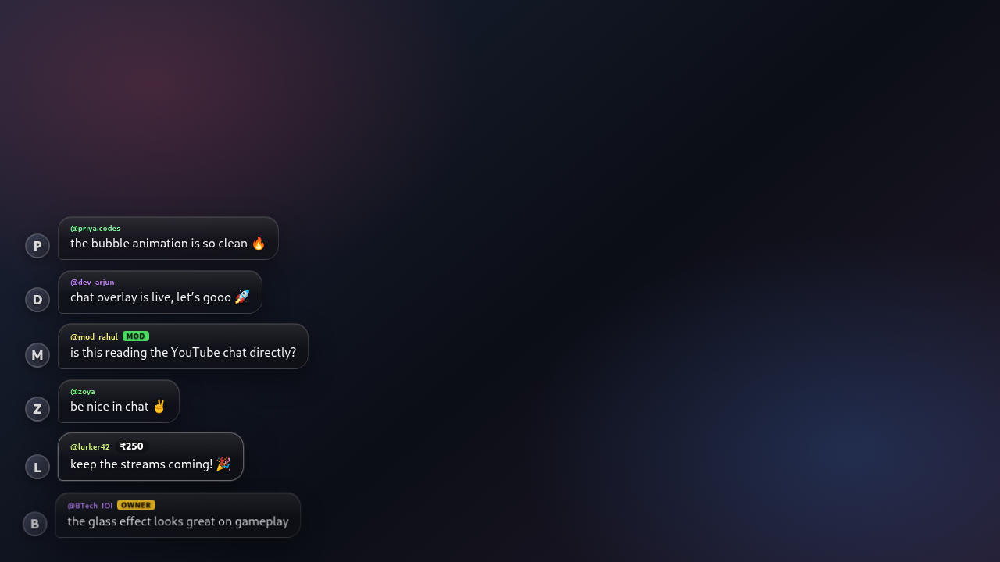
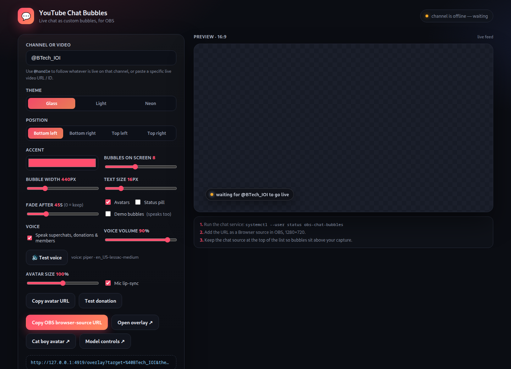
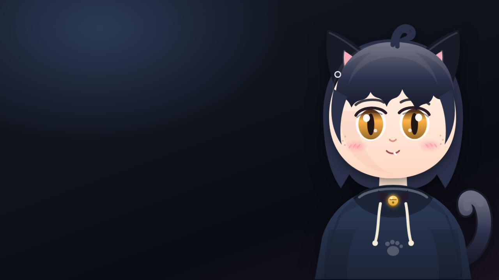
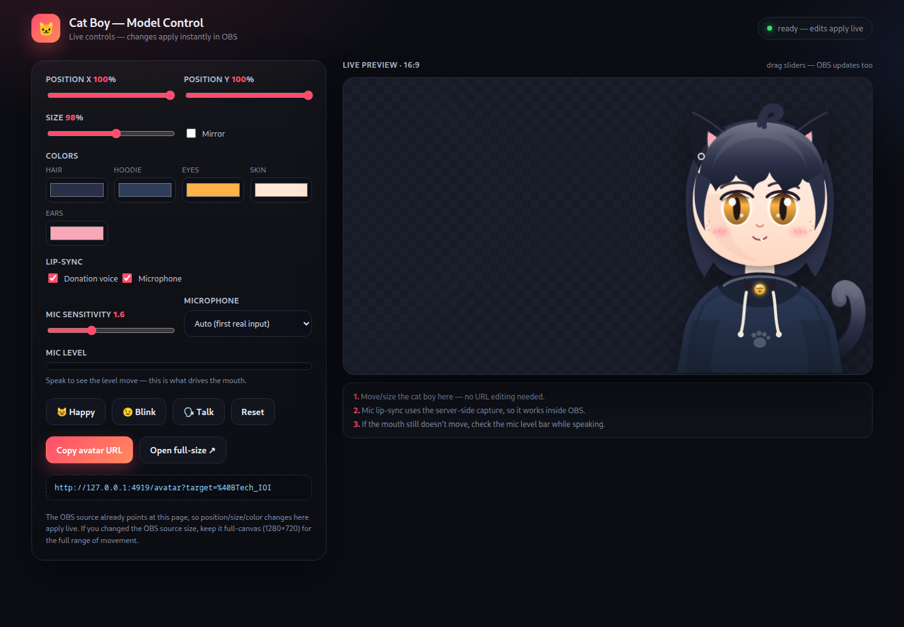

# YouTube Chat Bubbles for OBS

Live YouTube chat rendered as custom glass bubbles, as a transparent OBS browser
source — with a neural voice that reads superchats, donations and new memberships.
Built for **@BTech_IOI**: it automatically follows whatever is live on that channel
(no API key, no OAuth, no third-party overlay account).



*The control panel — every bubble setting lives here:*



## What was installed

| Piece | Where |
|---|---|
| OBS Studio 33.0.0 (Flatpak, Flathub) | user install, `com.obsproject.Studio` |
| Cat-boy avatar browser source | part of the **YT Chat Bubbles** scene |
| Chat-bubble service + Piper voice | `~/.local/share/obs-chat-bubbles` |
| systemd user service | `~/.config/systemd/user/obs-chat-bubbles.service` |
| OBS scene collection **YT Chat Bubbles** (scene **Main**) | `~/.var/app/com.obsproject.Studio/config/obs-studio/basic/scenes/` |
| Control panel | <http://127.0.0.1:4919/> |

The OBS collection already contains a **Browser** source called
*YouTube Chat Bubbles*, sized 1280×720 (720p), pointing at the local overlay.

## Start using it

OBS is set to **1280×720 @ 30 fps** (canvas and output). If you later switch to
1080p, set the canvas to 1920×1080 and resize the browser source to match.

1. Open OBS (app menu → OBS Studio, or `flatpak run com.obsproject.Studio`).
2. The **YT Chat Bubbles** scene collection is already selected, with scene **Main**.
3. Add your screen / game / camera capture to **Main**, then drag it **below**
   *YouTube Chat Bubbles* in the Sources list so the chat stays on top.
4. Go live on YouTube from `@BTech_IOI`. The overlay finds the live stream on its
   own and starts filling with bubbles within a few seconds.

Bubbles are transparent — nothing is drawn where there is no message, so it
composites over any scene.

## Customising

Open the control panel at <http://127.0.0.1:4919/>. Pick theme, position, accent
colour, bubble width, text size, how many bubbles stay on screen, and fade time.
The panel shows a live preview and a **Copy OBS browser-source URL** button.
Paste that URL into the OBS browser source (double-click the source → URL).

Query parameters you can also set by hand:

| Param | Values | Default |
|---|---|---|
| `target` | `@handle`, video URL or 11-char video id; or Twitch: `twitch:channel`, `#channel`, `twitch.tv/channel` | — (required) |
| `theme` | `glass`, `light`, `neon` | `glass` |
| `pos` | `bl`, `br`, `tl`, `tr` | `bl` |
| `max` | 3–30 bubbles on screen | `8` |
| `ttl` | seconds before a bubble fades, `0` = keep | `45` |
| `width` | bubble column width in px | `440` |
| `size` | message text size in px | `16` |
| `accent` | hex colour without `#` | `ff4d6d` |
| `edge` | margin from the screen edge in px | `32` |
| `avatars` | `0` to hide avatars | shown |
| `tts` | `1` to speak superchats & memberships | off (the OBS source enables it) |
| `vol` | voice volume, 0–1 | `0.9` |
| `status` | `1` to show a small "live / waiting" pill | off |
| `demo` | `1` to show fake bubbles (design testing) | off |

Example:

```
http://127.0.0.1:4919/overlay?target=%40BTech_IOI&theme=glass&pos=bl&max=8&width=440&size=16&ttl=45
```

## Voice for superchats, donations & memberships

Paid messages (superchats and stickers) and new memberships are read out loud with a
local **Piper** neural voice (`en_US-lessac-medium`) — fully offline, nothing is sent
to a cloud service.

- **Toggle:** control panel → *Speak superchats, donations & members*.
- **Volume:** *Voice volume* slider, 0–100 %.
- **Test voice:** plays a sample clip immediately.
- **Demo bubbles:** speaks too, so you can check the whole chain without going live.
- Spoken text: `"<name> sent <amount>. <message>"` / `"<name> just became a member. <message>"`.

URL parameters: `tts=1` turns speech on, `vol=0.9` sets the volume (0–1). The OBS
source already includes both.

The audio is played by the OBS browser source, so OBS mixes it into the stream. Keep
the source un-muted and its fader around 0 dB in the Audio Mixer. Synthesis takes
~0.3–1 s and clips are cached in `~/.cache/obs-chat-bubbles/tts`; playback is queued so
donations never talk over each other (if a flood arrives, the oldest queued clip is
dropped).

Piper lives in `~/.local/share/obs-chat-bubbles/piper` (~112 MB incl. the model). If
that folder is missing, the service falls back to `espeak-ng`; if neither exists,
bubbles stay silent. To turn speech off permanently, uncheck the voice box and copy
the new URL into OBS (or add `tts=0`).

## Cat boy avatar (VTuber)

A vector cat-boy "PNGTuber-style" avatar lives at `/avatar` and is in the OBS scene as
**Cat Boy Avatar** (full-canvas, above your capture, below the chat bubbles).



- **Idle:** breathing, head sway, tail sway, random blinks and ear twitches.
- **Talks:** the mouth follows the donation voice (clip length) and your microphone in
  real time. Mic capture is server-side (`parec`), so OBS never asks the browser for
  permission; only a loudness value is streamed.
- **Reacts:** superchats/members make him hop, sparkle and mouth-flap.
- **Moves:** position and size are controlled from the model panel, live.

### Model control panel

Open **<http://127.0.0.1:4919/model>** (also linked from the chat panel as
*Model controls*).



- **Position X / Y, Size, Mirror** — updates the OBS overlay instantly; no URL editing.
- **Colors** — hair, hoodie, eyes, skin, inner ears.
- **Lip-sync** — donation voice on/off, microphone on/off, sensitivity, and the specific
  microphone to capture (monitor sources are marked 🔊).
- **Mic level meter** — talk and watch it move; this is exactly what drives the mouth.
- **Happy / Blink / Talk** — test expressions without a donation.
- **Reset** — back to defaults.
- Settings are stored in `~/.local/share/obs-chat-bubbles/avatar-config.json` and applied
  to every avatar page (OBS + preview) through a small SSE feed.

### URL parameters

The panel is easiest, but the page still accepts overrides:

```
http://127.0.0.1:4919/avatar?target=%40BTech_IOI
```

| Param | Values | Default |
|---|---|---|
| `target` | channel/video to react to | — |
| `x`, `y` | anchor position, 0–1 | `0.99`, `0.99` (bottom-right) |
| `size` | height as fraction of the canvas | `0.94` |
| `flip` | `1` to mirror him | off |
| `mic` | `0` to disable mic lip-sync | on |
| `gain` | mic sensitivity, `0.2`–`6` | `1.6` |
| `hair`, `hoodie`, `eye`, `skin`, `ears` | hex colours | navy / indigo / amber |
| `demo` | `1` to loop talk + happy reactions | off |

**If the mouth doesn't move:** the OBS page may be a cached copy from before an update —
right-click **Cat Boy Avatar → Refresh page** (or restart OBS). Then open `/model`, speak,
and confirm the mic level bar moves. The service re-reads the microphone each time it
starts capturing; pick a device in the panel if auto-selection guesses wrong.

The avatar source is muted — the donation voice still plays from the chat overlay source.
The **Test donation** button in the chat panel fires a fake superchat through the room
(bubble + voice + avatar reaction) without saving it to chat history.

## Service

```bash
systemctl --user status obs-chat-bubbles     # is it running?
systemctl --user restart obs-chat-bubbles    # restart
systemctl --user stop obs-chat-bubbles       # stop
journalctl --user -u obs-chat-bubbles -f     # live logs
```

It starts automatically at login and restarts itself if it crashes. It only
listens on `127.0.0.1:4919`.

To re-install/update from this folder:

```bash
./install.sh
```

## How it works

- `server.js` serves the overlay and a small SSE feed (`/events`).
- It reads YouTube's **public** live chat through the Innertube API
  (`youtubei.js`), so no API key or login is involved. Chat is read-only.
- For `@handle` targets it resolves the channel's `/live` page every ~12 s while
  offline, then connects to the live chat of whichever video is live.
- Bubbles arrive with ~2–5 s delay vs the real chat (same as YouTube's own chat).
- Emotes, member/mod/owner badges, superchats and memberships get their own
  bubble styling; messages deleted by moderators disappear from the overlay.

Latency and reliability depend on YouTube's private web API; if YouTube changes
its payloads, update the dependency:

```bash
cd ~/.local/share/obs-chat-bubbles && npm install youtubei.js@latest
systemctl --user restart obs-chat-bubbles
```

## Troubleshooting

**Overlay is blank / no bubbles**
- Is the channel actually live? `@BTech_IOI` not live → the overlay waits quietly.
- Check the service: `systemctl --user status obs-chat-bubbles`.
- In OBS, right-click the source → *Refresh page* after a restart of the service.
- Make sure the source is at the top of the Sources list and visible (eye icon).

**Bubbles look washed out on a very bright scene**
- Use the `light` theme, or raise the bubble opacity in `public/overlay.css`
  (`--bubble-bg`), then restart the service.

**OBS asks to choose a screen every launch**
- That is the Wayland/PipeWire portal for *your* capture source; pick "Share"
  once and OBS remembers the choice for the session.

**Mouth doesn't move**
- Donations: check the voice is on and `journalctl --user -u obs-chat-bubbles -f | grep tts`
  shows a clip; then use **Test donation** in the panel.
- Mic: `pactl get-default-source` should be your real microphone (not a monitor), and it
  must be unmuted. The service re-reads the default source each time it starts capturing,
  so `systemctl --user restart obs-chat-bubbles` after changing devices.
- Raise `gain=2.5` in the avatar URL if your mic is quiet.

**No voice for donations**
- Control panel: voice toggle on, volume above 0, press **Test voice**.
- OBS Audio Mixer: the *YouTube Chat Bubbles* source must not be muted.
- `journalctl --user -u obs-chat-bubbles -f | grep tts` prints `playback started` when
  OBS actually plays a clip; `blocked: NotAllowedError` means right-click the source →
  *Refresh page* (OBS restarts its browser engine).

**Wrong scene collection showing**
- OBS menu → *Scene Collection* → **YT Chat Bubbles**.

**Port already in use**
- Something else is on 4919. Change `Environment=PORT=…` in the unit and the URL
  in the OBS source to match.

## Files

```
obs-chat-bubbles/
├── server.js              # HTTP + SSE + YouTube chat bridge
├── tts.js                 # Piper / espeak-ng speech synthesis
├── public/avatar.html/css/js  # the cat-boy rig
├── public/
│   ├── overlay.html/css/js  # the bubble overlay itself
│   └── control.html/css/js  # control panel
├── obs/YT_Chat_Bubbles.json # OBS scene collection (template)
├── piper/                 # (installed copy only) Piper engine + voice model
├── systemd/obs-chat-bubbles.service
├── docs/                    # screenshots
└── install.sh
```

The copy in `~/.local/share/obs-chat-bubbles` is what the service runs; edit
there (or edit here and run `./install.sh`).
